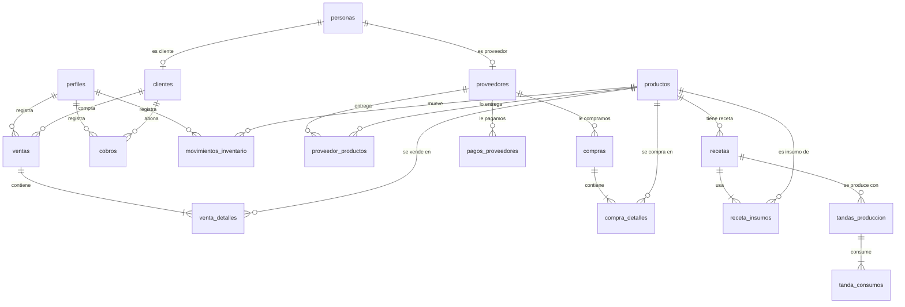

# App Rosquillas: diseño de la base de datos

Borrador 4 (22 de noviembre de 2026), para revisar antes de escribir las migraciones en `rosquillas-backend`. Motor: PostgreSQL en Supabase.

## 1. Análisis de los cambios propuestos

Cada idea se revisó para ver si encaja con el proyecto. Donde hay más de un camino viable, se dan las opciones y la recomendada.

### 1.1 "Los usuarios son de Android y no hay perfil de cliente, solo uso administrativo"

**Encaja y simplifica.** Los únicos usuarios con cuenta son tú y tus familiares. Los clientes y proveedores son **registros**, no usuarios: nunca inician sesión.

- Instalar el APK en Android es gratis, así que no hace falta pagar tienda.
- Recomiendo **seguir con Expo**. Seguir en Android no cuesta nada extra, y si un día alguien de la familia usa iPhone, el mismo código sirve. Lo que cambia es que solo se prueba y se empaqueta para Android.

### 1.2 Separar clientes y proveedores en personas físicas y jurídicas

**La idea es buena, pero no conviene hacer tablas separadas.** Con `clientes_fisicos`, `clientes_juridicos`, `proveedores_fisicos` y `proveedores_juridicos` quedan cuatro tablas casi iguales. Además, una venta tendría que apuntar a dos tablas distintas, y eso rompe las llaves foráneas y complica los reportes.

| Opción | Cómo es | A favor | En contra |
|---|---|---|---|
| A. Cuatro tablas | Una por combinación | Fácil de entender al inicio | Datos duplicados, llaves foráneas imposibles, reportes con `UNION` |
| B. Columna de tipo en `clientes` y en `proveedores` | `tipo_persona = 'fisica' / 'juridica'` y restricciones `CHECK` | Simple | Si un proveedor también te compra, queda registrado dos veces |
| **C. Supertipo `personas` (recomendada)** | Una tabla `personas` con los datos de identidad (física o jurídica) y dos tablas de rol: `clientes` y `proveedores` | Sin duplicados, una persona puede ser cliente y proveedor a la vez, llaves foráneas limpias y es un patrón clásico de modelado (generalización y especialización) | Una tabla más y una unión en las consultas, que se resuelve con vistas |

Con la opción C, la cédula se valida según su tipo, tal como se usa en Costa Rica: física de 9 dígitos, jurídica de 10 y DIMEX de 11 o 12.

### 1.3 Recurrente, casual y esporádico

Esta clasificación **no es lo mismo** que física o jurídica. Son dos dimensiones distintas: una persona jurídica puede ser recurrente o casual. Tampoco recomiendo guardarla como una etiqueta escrita a mano, porque se desactualiza: alguien marcado como "casual" que empieza a comprar cada semana seguiría apareciendo como casual.

Recomendación:
- **Esporádico** = venta sin cliente (`cliente_id` vacío). Siempre se paga en el momento.
- **Recurrente o casual** se **calcula** a partir de la frecuencia de compra, en una vista. Por ejemplo, recurrente si compró en 3 o más semanas distintas de los últimos 2 meses. El criterio se puede ajustar.
- Lo que sí se guarda es una decisión de negocio: **`credito_habilitado`**, que indica si a ese cliente se le puede fiar, y opcionalmente un **`limite_credito`**.

Alternativa viable: guardar la etiqueta manual **y** mostrar al lado la calculada, para que el admin la corrija. Es más trabajo y aporta poco.

### 1.4 Sin métodos de pago, solo pagos y abonos a la cuenta

**Encaja.** No hay tabla de métodos de pago. Para que el saldo siempre cuadre con una sola regla:

- Cada venta a un cliente registrado carga su **cuenta**.
- Cada pago o abono la descarga.
- **Saldo = total de ventas − total de pagos.**
- Una venta de contado es una venta más un pago por el mismo monto, registrados juntos. Así no hay dos lógicas distintas para contado y crédito, y los reportes salen de la misma fuente.
- Cada pago guarda **quién lo registró** (tú o un familiar) y la fecha.

Una sugerencia que no contradice tu idea: dejar en `cobros` un campo opcional `nota` de texto libre (por ejemplo "SINPE, comprobante 1234"). No es un método de pago, pero sirve si un día hay que aclarar un abono.

### 1.5 Producción: ustedes fabrican las rosquillas

Hay dos tipos de inventario: **insumos** (harina, queso, manteca, empaques), que entran de proveedores, y **producto terminado** (rosquillas), que sale en ventas. Los une la **producción**:

- Cada producto terminado tiene una **receta** (`recetas` y `receta_insumos`): cuánto de cada insumo se usa por tanda y cuántas unidades rinde.
- Al registrar una **tanda de producción** (`tandas_produccion`), la base descuenta los insumos según la receta y suma las rosquillas producidas.
- Si una tanda real usó más o menos de lo que dice la receta, se pueden corregir las cantidades consumidas de esa tanda. Así el inventario de insumos se parece a la realidad.
- Con esto también se puede calcular el **costo por rosquilla** (insumos usados ÷ unidades producidas), útil para saber si el precio de venta deja ganancia.

### 1.6 Cuentas por pagar a proveedores

Funciona igual que la cuenta de los clientes, pero al revés:
- Cada compra a un proveedor carga su cuenta. Se marca como de contado o a crédito.
- Cada pago al proveedor (`pagos_proveedores`) la descarga.
- **Saldo con el proveedor = compras − pagos.**

Usar la misma lógica en los dos lados hace el sistema más fácil de entender y de probar.

### 1.7 Quién ve los saldos

"Familiar" es el rol básico de la familia (antes se llamaba "vendedor"). Nadie fuera de la familia tiene acceso. Todos los roles ven el **saldo de los clientes** (`v_saldo_clientes`), porque lo necesitan para cobrar y fiar. El **saldo con proveedores** (`v_saldo_proveedores`) lo ven solo admin y super admin, por suposición: avisa si también debe verlo el familiar. La función `puede_fiar(cliente_id, monto)` sigue validando el límite de crédito al vender.

### 1.8 Siempre debe haber stock para vender

La base rechaza una venta o una tanda de producción si no hay existencia suficiente. Pero esta regla **choca con el modo sin internet**: un celular sin señal no sabe si otro familiar vendió las últimas rosquillas hace cinco minutos. Si los dos venden sin conexión, al sincronizar puede faltar stock.

| Opción | Cómo funciona | A favor | En contra |
|---|---|---|---|
| A. Vender solo con internet | Sin señal no se puede vender | La regla se cumple siempre | Se pierde el modo sin internet, que era deseable |
| **B. Validar con el stock local y resolver al sincronizar (recomendada)** | Sin señal, el celular valida con la última existencia que conoce. Al sincronizar, si ya no alcanzaba, la venta queda **en revisión** para que un admin la apruebe o la corrija | Se puede vender sin señal y nunca se pierde una venta | Puede haber algún caso raro que revisar a mano |
| C. Stock asignado por familiar | Cada familiar "carga" una cantidad de rosquillas y solo vende de esa carga | Nunca hay choques, incluso sin internet | Hay que registrar cada carga y cada devolución, lo que solo vale la pena si venden en lugares distintos |

**Decisión:** opción B, con stock general para toda la familia. La opción C se descartó porque frena el flujo.

## 2. Diagrama entidad-relación

## 3. Tablas

Convenciones: nombres en español y `snake_case`, llaves `uuid` (necesarias para crear registros sin internet y sincronizarlos después sin choques), fechas `timestamptz` y dinero en **colones enteros** (`bigint`).

Todas las tablas de catálogo (`personas`, `clientes`, `proveedores`, `productos`) llevan:
`activo boolean default true` (deshabilitar), `eliminado_en timestamptz null` (borrado lógico, solo super admin), `creado_en`, `creado_por`, `actualizado_en` y `actualizado_por`.

### Usuarios
| Tabla | Columnas clave | Notas |
|---|---|---|
| `perfiles` | `id` (= `auth.users.id`), `nombre_completo`, `rol` (`super_admin`, `admin`, `familiar`), `activo` | Solo familia. Se crea al dar de alta el usuario. |

### Personas
| Tabla | Columnas clave | Notas |
|---|---|---|
| `personas` | `id`, `tipo_persona` (`fisica`, `juridica`), `tipo_identificacion` (`cedula_fisica`, `cedula_juridica`, `dimex`, `ninguna`), `numero_identificacion` (único si existe), `nombre`, `apellidos` (física), `razon_social`, `nombre_comercial` (jurídica), `telefono`, `correo`, `direccion`, `notas` | `CHECK`: si es física, `nombre` es obligatorio; si es jurídica, `razon_social` es obligatorio. La cédula es opcional para no frenar el registro de un cliente nuevo. |
| `clientes` | `persona_id` (PK y FK), `credito_habilitado`, `limite_credito` | Rol de cliente. |
| `proveedores` | `persona_id` (PK y FK) | Rol de proveedor. |

### Productos
| Tabla | Columnas clave | Notas |
|---|---|---|
| `productos` | `id`, `nombre`, `clase` (`insumo`, `producto_terminado`), `unidad` (`unidad`, `kg`, `g`, `l`, `paquete`), `precio_venta` (si se vende), `stock_minimo` | `nombre` único entre los activos. |
| `proveedor_productos` | `proveedor_id`, `producto_id`, `ultimo_costo` | Qué producto entrega cada proveedor (relación N a N). |

### Ventas y cuentas
| Tabla | Columnas clave | Notas |
|---|---|---|
| `ventas` | `id`, `cliente_id` (null = esporádico), `vendido_en`, `total`, `estado` (`activa`, `anulada`), `motivo_anulacion`, `registrado_por` | No se edita: si hay un error se anula con motivo y se registra de nuevo. `CHECK`: sin cliente, la venta debe pagarse completa en el momento. |
| `venta_detalles` | `venta_id`, `producto_id`, `cantidad`, `precio_unitario`, `total_linea` | Guarda el precio **del momento**, así un cambio de precio no altera ventas viejas. |
| `cobros` | `id`, `cliente_id`, `venta_id` (opcional: abono a una venta o a la cuenta en general), `monto > 0`, `pagado_en`, `nota`, `estado`, `registrado_por` | Pagos y abonos. Los errores se anulan, no se borran. |

### Inventario
| Tabla | Columnas clave | Notas |
|---|---|---|
| `compras` | `id`, `proveedor_id`, `comprado_en`, `total`, `es_credito`, `estado`, `registrado_por` | Entrada de insumos de un proveedor. Las compras de contado generan su pago automáticamente. |
| `compra_detalles` | `compra_id`, `producto_id`, `cantidad`, `costo_unitario` | |
| `movimientos_inventario` | `id`, `producto_id`, `tipo` (`compra`, `venta`, `produccion_entrada`, `produccion_salida`, `ajuste`, `anulacion`), `cantidad` (+ entra, − sale), `tabla_origen`, `origen_id`, `movido_en`, `registrado_por` | **Libro mayor del inventario.** La existencia es la suma de los movimientos. Los movimientos se crean con *triggers* al registrar ventas y compras, nunca a mano, salvo los ajustes. |
| `pagos_proveedores` | `id`, `proveedor_id`, `compra_id` (opcional), `monto > 0`, `pagado_en`, `nota`, `estado`, `registrado_por` | Pagos y abonos a proveedores. |
| `recetas` | `id`, `producto_id` (terminado), `rendimiento`, `activo` | Una receta activa por producto. Se versiona: si cambia, se crea otra y la vieja queda inactiva, así las tandas viejas no cambian. |
| `receta_insumos` | `receta_id`, `insumo_id` (insumo), `cantidad` | |
| `tandas_produccion` | `id`, `receta_id`, `producido_en`, `cantidad_producida`, `estado`, `registrado_por` | Una tanda. Genera movimientos `produccion_entrada` (rosquillas) y `produccion_salida` (insumos). |
| `tanda_consumos` | `tanda_id`, `insumo_id`, `cantidad` | Lo que se consumió de verdad. Se llena con la receta y se puede corregir. |

### Auditoría
| Tabla | Columnas clave | Notas |
|---|---|---|
| `bitacora` | `id`, `tabla`, `registro_id`, `accion` (`creacion`, `edicion`, `deshabilitacion`, `eliminacion`, `anulacion`), `datos_anteriores jsonb`, `datos_nuevos jsonb`, `usuario_id`, `fecha` | Se llena con un *trigger* genérico. Nadie puede editarla ni borrarla, ni siquiera el super admin. |

## 4. Vistas, reglas y permisos

**Vistas para la app y los reportes**
- `v_saldo_clientes`: saldo por cliente (ventas activas − pagos activos). Todos los roles.
- `v_saldo_proveedores`: saldo con cada proveedor (compras a crédito − pagos). Solo admin.
- `v_costo_tandas`: costo de insumos por tanda y por unidad.
- `v_existencias`: existencia por producto y alerta si está bajo `stock_minimo`.
- `v_segmento_clientes`: recurrente o casual, calculado por frecuencia.
- `v_ranking_mensual_clientes`: clientes que más compran en el mes.
- `v_promedios_mensuales`: promedio de ventas y de entradas por cliente, por proveedor y general.

**Reglas que hace cumplir la base (no solo la app)**
- Montos y cantidades mayores que 0 (`CHECK`).
- No vender más que la existencia, ni producir sin insumos suficientes (ver 1.8 para el caso sin internet).
- No fiar a un cliente sin `credito_habilitado` ni por encima de su `limite_credito`.
- No se pueden crear ventas ni pagos para clientes deshabilitados.

**Permisos con RLS**
| Acción | familiar | admin | super_admin |
|---|---|---|---|
| Ver clientes y productos | ✓ | ✓ | ✓ |
| Ver saldos de clientes | ✓ | ✓ | ✓ |
| Ver saldos con proveedores | | ✓ | ✓ |
| Registrar tandas de producción | ✓ | ✓ | ✓ |
| Editar recetas | | ✓ | ✓ |
| Registrar ventas, cobros y compras | ✓ | ✓ | ✓ |
| Registrar pagos a proveedores | | ✓ | ✓ |
| Anular una venta o un pago | | ✓ | ✓ |
| Crear, editar o deshabilitar catálogos | | ✓ | ✓ |
| Borrado lógico (`eliminado_en`) | | | ✓ |
| Gestionar usuarios | | | ✓ |
| Ver la bitácora de auditoría | | ✓ | ✓ |

Nadie tiene permiso de `DELETE` físico desde la app. Los respaldos los hace Supabase (diarios en el plan gratis por 7 días) y además se puede programar una exportación propia.

## 5. Decisiones tomadas

1. Fabrican las rosquillas: hay recetas y tandas de producción.
2. A algunos proveedores se les debe: hay cuentas por pagar.
3. Todos los roles ven el saldo de los clientes. El saldo con proveedores es solo para admin (suposición).
4. Siempre debe haber stock para vender, y el stock es **general** (compartido por toda la familia). Sin internet se aplica la opción B de la sección 1.8: se valida con el último stock conocido y, si al sincronizar no alcanzaba, la venta queda en revisión para un admin.

## 6. Mejoras tomadas de tus proyectos anteriores

Revisé el material de SIAPB (Ingeniería II), la guía de defensa de base de datos de la ASADA, la exposición de seguridad y pruebas, y la metodología UX. Esto es lo que se traslada, adaptado a PostgreSQL y Supabase.

### 6.1 La lógica vive en funciones de la base, no en tablas abiertas
En la ASADA, los roles tenían `EXECUTE` sobre procedimientos y no acceso directo a las tablas. Aquí se hace lo mismo:
- La app **no escribe directo** en `ventas`, `cobros`, `compras` ni `tandas_produccion`. Llama funciones RPC transaccionales: `registrar_venta()`, `registrar_cobro()`, `registrar_compra()`, `registrar_tanda()` y `anular_venta()`.
- Cada función valida el permiso, el stock y el crédito, escribe la venta y sus movimientos de inventario **en una sola transacción**, y deja la auditoría. Si algo falla, no queda nada a medias.
- Con RLS se niega `INSERT`, `UPDATE` y `DELETE` directo a esas tablas para el rol `authenticated`. Las funciones son `SECURITY DEFINER` y tienen `search_path` fijo.

### 6.2 Permisos como datos, no escritos en el código
Igual que `fn_TienePermiso`: tablas `roles`, `permisos` y `rol_permisos`, más una función `tiene_permiso('ventas.anular')` que usan tanto las políticas RLS como las funciones. Un cambio de rol aplica de inmediato. Se protege que el super admin no pueda quitarse su propio rol.

### 6.3 Seguridad *fail-closed*
- Ante cualquier duda se niega. RLS está activo en **todas** las tablas desde la primera migración, y una tabla sin política no devuelve nada.
- La identidad sale siempre de `auth.uid()`, nunca de un dato que mande la app.
- En el celular, la sesión se guarda en `expo-secure-store` (almacenamiento cifrado), no en `AsyncStorage`. Es el equivalente de "el token nunca en `localStorage`".
- Una cuenta desactivada pierde el acceso en la siguiente petición, porque `tiene_permiso()` revisa `perfiles.activo`.

### 6.4 Esquemas en lugar de filegroups
PostgreSQL no tiene filegroups y Supabase no permite tablespaces propios. La separación por área se logra con **esquemas**: `ventas`, `inventario`, `catalogo`, `seguridad` y `auditoria`. Ordenan la base, permiten dar permisos por área y hacen más legibles los respaldos.

### 6.5 Estimación de tamaño (mismo método de la ASADA)
Supuestos de un negocio familiar, a 10 años: 60 ventas al día con 2 líneas cada una, 1 cobro por cada 3 ventas, 2 tandas al día y 5 compras a la semana.

| Tabla | Filas a 10 años | Bytes por fila (aprox.) | MB con índices (+40 %) |
|---|---|---|---|
| `ventas` | 219 000 | 120 | 35 |
| `venta_detalles` | 438 000 | 80 | 47 |
| `movimientos_inventario` | ≈ 1 000 000 | 100 | 134 |
| `cobros` | 73 000 | 110 | 11 |
| `bitacora` (con JSON) | ≈ 900 000 | 400 | 482 |
| Resto (catálogos, compras, tandas) | < 50 000 | — | < 10 |
| **Total** | | | **≈ 720 MB** |

El plan gratis de Supabase da **500 MB**, así que se llegaría al límite en unos 6 a 7 años, casi todo por la bitácora. Decisiones:
- La bitácora guarda solo las **columnas que cambiaron**, no la fila completa, lo que la reduce a menos de la mitad.
- Una vista `v_tamano_tablas` permite revisar el tamaño desde la app de admin.
- Se puede archivar la bitácora de más de 2 años en un archivo exportado.

### 6.6 Formato único de errores en español
Las funciones lanzan errores con un código propio (`STOCK_INSUFICIENTE`, `SIN_PERMISO`, `CREDITO_EXCEDIDO`, `CLIENTE_INACTIVO`, `DATOS_INVALIDOS`) y un mensaje claro. La app los traduce a mensajes por campo, sin mostrar nunca un texto técnico.

### 6.7 Validaciones iguales en la app y en la base
Una sola fuente por regla: cédula física de 9 dígitos, jurídica de 10 y DIMEX de 11 o 12, teléfono de Costa Rica y montos positivos. Estas reglas viven como `CHECK` y funciones en la base, y el frontend las replica en `src/lib/validaciones.ts`, con pruebas que comparan los dos lados.

### 6.8 Pruebas contra PostgreSQL real
Igual que en tu exposición (Testcontainers y nunca una base en memoria): las pruebas de la base corren con **pgTAP** sobre Supabase local en Docker. GitHub Actions las ejecuta en cada pull request y falla si alguna no pasa.
